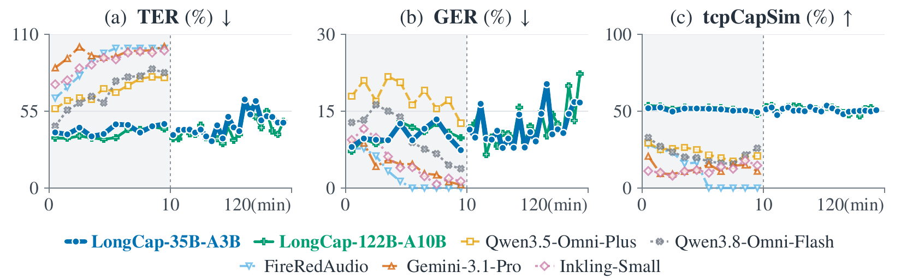
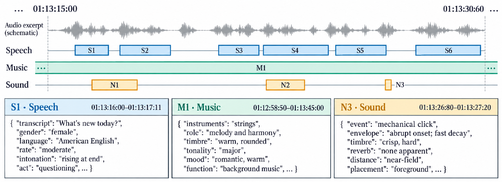
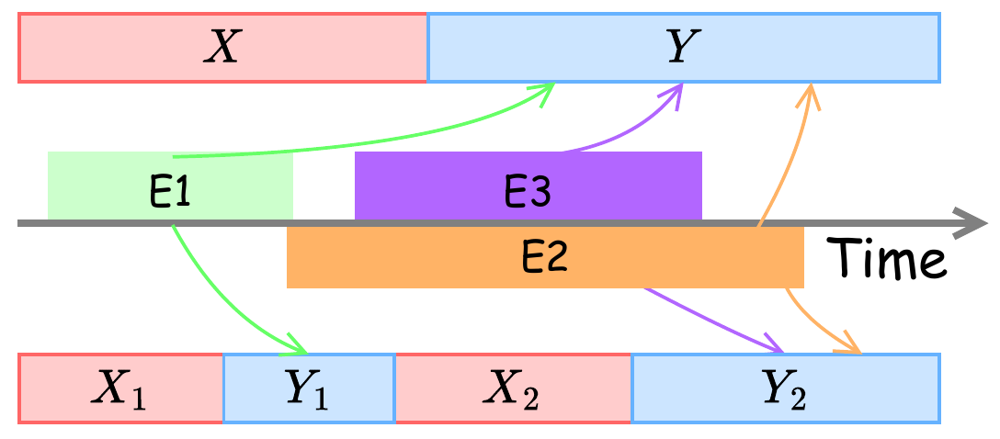

<h1 align="center">LongCap</h1>

<p align="center"><b>Hour-Scale Timestamped Audio Captioning via Chunk-wise Processing</b></p>

<p align="center">
Jinchuan Tian, Sen Chen, Wenbin Huang, Chao Weng, Zhengwei Huang, Jiatong Shi, Yichen Lu, Haoran Wang, Shinji Watanabe, and Cong Zhou
</p>

<p align="center">
Paper (arXiv, coming soon) · <a href="https://jctian98.github.io/longcap/">Project page</a> · <a href="https://huggingface.co/JinchuanTian/LongCap-35B-A3B-FP8">Model (FP8)</a> · <a href="https://huggingface.co/JinchuanTian/LongCap-35B-A3B">Model (BF16)</a> · <a href="https://huggingface.co/datasets/JinchuanTian/LongCapBench-TAC-Long">Benchmark</a>
</p>

<p align="center">
<a href="LICENSE"></a>

<a href="https://huggingface.co/JinchuanTian/LongCap-35B-A3B-FP8"></a>
<a href="https://huggingface.co/datasets/JinchuanTian/LongCapBench-TAC-Long"></a>
</p>

**LongCap** turns a recording, from a few seconds up to about two hours, into a timeline of speech, music, and sound events. Each event has start and end times and structured attributes, and the same model also transcribes speech with speaker labels. This repository contains the inference code: a custom vLLM server, a lightweight CPU client, and a Docker image.

<p align="center"></p>

*Caption quality over time on LongCapBench-TAC-Long (lower TER and GER and higher tcpCapSim are better). Left of each divider: independent 10-minute segments, where other systems degrade within minutes. Right: LongCap's single pass over full recordings of up to two hours.*

## Overview

### Timestamped audio captioning

<p align="center"></p>

*Schematic of the output, with English attribute names for readability.*

Timestamped audio captioning (TAC) describes every event in a recording. Speech, music, and sound events may overlap, and each one is localized and described on its own. An event has a `type` (`speech`, `music`, or `sound_event`), the attributes that apply to it, and a short `caption`. The attributes come from 62 keys designed with audio professionals from the speech, music, and film industries: for example, the transcript and speaker traits for speech, instruments and tempo for music, and the source and distance of a sound. Attribute names and values are written in Chinese, while transcripts and lyrics keep the spoken language; the model repository's [`attribute_keys.json`](https://huggingface.co/JinchuanTian/LongCap-35B-A3B-FP8/blob/main/attribute_keys.json) gives the English name of every key.

The released checkpoint performs two tasks with the same server:

| Task | Command | Output |
| --- | --- | --- |
| Timestamped audio captioning | `longcap caption` | Speech, music, and sound events with times and attributes |
| Speech recognition and diarization | `longcap diarize` | Transcript segments with times and speaker labels |

### Chunk-wise processing

<p align="center"></p>

*Top: holistic processing reads the whole recording X before writing all events Y. Bottom: chunk-wise processing alternates audio chunks and their events.*

Most audio language models read the entire recording before writing anything, so on long inputs every description must be retrieved from far back in the context, and quality drops beyond the lengths seen in training. LongCap instead works chunk by chunk:

1. The recording is split into consecutive chunks of 8, 16, 24, or 32 seconds.
2. After each chunk, the model writes every event that ends in that chunk.
3. Timestamps are relative to the chunk start; the client converts them to recording time.
4. All earlier audio and generated events stay in context, up to 1M tokens.

Because each step is the same local operation, the model extends to recordings far longer than its training examples, which are at most 20 minutes long. The model is a Qwen3.5-35B-A3B language model (mixture of experts, about 3B active parameters per token) fed by the Qwen3-Omni-Captioner audio encoder through a linear adaptor, with all parameters trained.

### Results

Timestamped audio captioning on LongCapBench-TAC-Short (1,500 human-annotated clips of up to one minute):

| System | TER (%) &darr; | GER (%) &darr; | tcpCapSim (%) &uarr; |
| --- | ---: | ---: | ---: |
| **LongCap-35B-A3B** | **13.01** | 15.93 | **64.59** |
| Qwen3.5-Omni-Plus | 13.22 | **12.21** | 52.66 |
| Qwen3.8-Omni-Flash | 20.88 | 17.67 | 48.43 |
| FireRedAudio | 43.79 | 15.82 | 37.81 |
| Gemini-3.1-Pro | 50.36 | 17.48 | 36.24 |
| Inkling-Small | 51.54 | 17.34 | 29.70 |

On [LongCapBench-TAC-Long](https://huggingface.co/datasets/JinchuanTian/LongCapBench-TAC-Long), four human-annotated recordings of 94 to 117 minutes, LongCap's caption similarity stays near 50% over the full two hours, while the other systems degrade within the first ten minutes (figure above). A single pass over each full recording scores 44.84% TER, 11.46% GER, and 50.85% tcpCapSim.

Speech recognition and diarization with the same checkpoint:

| Benchmark | WER (%) &darr; | DER (%) &darr; | tcpWER (%) &darr; |
| --- | ---: | ---: | ---: |
| AliMeeting | 20.43 | 5.10 | 17.35 |
| AISHELL-4 | 14.21 | 10.68 | 20.46 |
| AMI (IHM) | 19.36 | 9.66 | 14.48 |
| AMI (SDM) | 33.41 | 23.58 | 33.86 |

TER, GER, and tcpCapSim measure timeline errors, event segmentation errors, and attribute-level caption similarity; the paper defines them. All scores use the FP8 checkpoint, and failed or partial outputs stay in the scores. The paper's best diarization results come from a separate diarization-specialized model that is not part of this release.

## Release

| Component | Location | Notes |
| --- | --- | --- |
| LongCap-35B-A3B-FP8 | [Hugging Face](https://huggingface.co/JinchuanTian/LongCap-35B-A3B-FP8) | 38.4 GB, one H100 80GB; used for all reported scores |
| LongCap-35B-A3B | [Hugging Face](https://huggingface.co/JinchuanTian/LongCap-35B-A3B) | BF16, 70.6 GB, two H100 80GB |
| LongCapBench-TAC-Long | [Hugging Face](https://huggingface.co/datasets/JinchuanTian/LongCapBench-TAC-Long) | Human-annotated labels and source links; no audio included |
| Inference image | `ghcr.io/jctian98/longcap:0.1.0-rc.2` | vLLM server and CLI; weights are mounted separately |
| Inference code | This repository | Apache-2.0 |

The checkpoint is LongCap-SFT-2 at step 3000. It does not predict links between events; that ability comes from an optional training stage in the paper that is not part of this release.

## Quickstart

LongCap runs as a GPU server (a custom vLLM build, shipped as a Docker image) and a CPU client that sends audio to it. You need Linux x86-64, Docker with the NVIDIA Container Toolkit, an NVIDIA driver compatible with CUDA 13.0, and Python 3.12 for the client.

### 1. Choose a checkpoint

| Checkpoint | Precision | Download | GPUs |
| --- | --- | ---: | --- |
| [LongCap-35B-A3B-FP8](https://huggingface.co/JinchuanTian/LongCap-35B-A3B-FP8) | FP8 MoE experts, BF16 elsewhere | 38.4 GB | 1x H100 80GB |
| [LongCap-35B-A3B](https://huggingface.co/JinchuanTian/LongCap-35B-A3B) | BF16 | 70.6 GB | 2x H100 80GB |

The two precisions produce nearly identical output ([validation](VALIDATION.md#bf16-checkpoint)). BF16 does not fit on one 80 GB GPU: its weights take 65.9 GiB, leaving too little memory for the KV cache.

### 2. Install the client and download the model

```bash
git clone https://github.com/jctian98/longcap-code.git
cd longcap-code
python3.12 -m venv .venv
source .venv/bin/activate
python -m pip install --require-hashes -r requirements/client.lock
python -m pip install --no-deps .

MODEL=LongCap-35B-A3B-FP8   # or LongCap-35B-A3B for BF16
hf download JinchuanTian/$MODEL --local-dir ./models/$MODEL
longcap verify-model --model ./models/$MODEL
```

`verify-model` hashes every runtime file listed in the model's `SHA256SUMS`; keep that file with the download. Use `hf auth login` if repository access requires authentication.

### 3. Start the server

**FP8, one GPU:**

```bash
mkdir -p cache
docker run --rm --gpus '"device=0"' --shm-size=16g -p 127.0.0.1:20000:20000 \
  -v "$PWD/models/$MODEL:/models/longcap-35b-a3b:ro" \
  -v "$PWD/cache:/cache" \
  ghcr.io/jctian98/longcap:0.1.0-rc.2
```

**BF16, two GPUs.** `longcap serve` runs on one GPU, so this starts the server module directly with the same `long` profile settings plus `--tensor-parallel-size 2`:

```bash
mkdir -p cache
docker run --rm --gpus '"device=0,1"' --shm-size=16g -p 127.0.0.1:20000:20000 \
  -v "$PWD/models/$MODEL:/models/longcap-35b-a3b:ro" \
  -v "$PWD/cache:/cache" \
  --entrypoint python ghcr.io/jctian98/longcap:0.1.0-rc.2 \
  -m espnet2.speechlm.vllm.vllm_server.service \
  --model /models/longcap-35b-a3b --host 0.0.0.0 --port 20000 \
  --spool-dir /cache/audio-spool --tensor-parallel-size 2 \
  --gpu-memory-utilization 0.90 --max-model-len 1048576 \
  --yarn-factor 4 --yarn-original-max-position-embeddings 262144 \
  --max-num-seqs 4 --max-num-batched-tokens 16384 --mamba-ssm-cache-dtype float32 \
  --slice-cache-max 2048 --io-threads 4 --torch-num-threads 4 \
  --mm-processor-cache-gb 4 --max-audio-per-prompt 1024
```

Loading the weights and compiling kernels takes a few minutes; the server is ready when `http://127.0.0.1:20000/health` returns success. Use `docker login ghcr.io` if package access requires authentication.

### 4. Caption or diarize a recording

```bash
# Timestamped audio captioning
longcap caption --audio /absolute/path/to/example.wav --key example \
  --model ./models/$MODEL --service http://127.0.0.1:20000 \
  --output ./outputs/caption

# Speech recognition with speaker diarization
longcap diarize --audio /absolute/path/to/example.wav --key example \
  --model ./models/$MODEL --service http://127.0.0.1:20000 \
  --output ./outputs/diarization
```

Captions are written to `outputs/caption/predictions/predictions.jsonl`, one line per recording:

```json
{"key": "example", "duration": 96.0, "events": [{"start": 0.0, "end": 59.0, "attributes": {"type": "music", "caption": "..."}}]}
```

Diarization is written to `outputs/diarization/predictions/diarization.jsonl`:

```json
{"key": "example", "duration": 96.0, "segments": [{"start": 0.2, "end": 1.1, "speaker": "0", "text": "..."}]}
```

Times are seconds from the start of the recording. Speaker labels distinguish voices within a recording; they do not identify real people. Use `--manifest` instead of `--audio` for a batch of recordings, and separate output directories for each task. Rerun an identical command to resume an interrupted run. Check `raw/client.json` for coverage and errors; exit status 2 means some output is incomplete.

### Serving profiles

| Profile | Context | Use for |
| --- | ---: | --- |
| `long` (image default) | 1,048,576 tokens with YaRN | Recordings longer than a few minutes, and diarization |
| `short` | 131,072 tokens | Captioning short clips, with higher batch concurrency |

Use the `long` profile for diarization. In our release checks, diarization with the `short` profile stopped transcribing after the first minute of a five-minute excerpt with both precisions, while the `long` profile transcribed all of it.

To serve FP8 with the `short` profile, append `serve --model /models/longcap-35b-a3b --profile short --host 0.0.0.0 --port 20000` to the FP8 command. For BF16, change `--max-model-len` to `131072`, drop the two `--yarn` options, and set `--max-num-seqs 128 --slice-cache-max 16384 --io-threads 8 --mm-processor-cache-gb 8 --max-audio-per-prompt 64`.

## Documentation

| Guide | Contents |
| --- | --- |
| [Inference](docs/inference.md) | Batch manifests, decoding and retries, output files, resume |
| [Docker](docs/DOCKER.md) | Container requirements, running the client in a container, building the image |
| [Validation](VALIDATION.md) | Test results and known limitations of this release |
| [Contributing](CONTRIBUTING.md) | Development setup and tests |

The repository is organized as follows:

```text
src/longcap/                  CLI, client runner, audio preparation, output conversion
src/espnet2/speechlm/vllm/    vLLM model, multimodal plugin, and HTTP server
docker/                       Dockerfile and environment check
requirements/                 Hash-locked client and server dependencies
tests/                        CPU test suite (no GPU or model weights needed)
```

## Disclaimer

LongCap is a research release, intended for research use. It is not a product or a hosted service and has not been validated for production use. Like other AI models, it can make mistakes: it may miss or invent events, give wrong timestamps, mistranscribe speech, or mislabel speakers. Attributes such as a speaker's gender, age, or emotion are inferred from audio and may be wrong or biased. Review outputs before relying on them, and do not use them to identify people or to make decisions about them. You are responsible for how you use the model and its outputs, including having the right to process the audio you provide. The software and weights are provided "as is", without warranty of any kind, under the Apache License 2.0.

## Citation

If you use LongCap, please cite:

```bibtex
@misc{tian2026longcap,
  title = {LongCap: Hour-Scale Timestamped Audio Captioning via Chunk-wise Processing},
  author = {Tian, Jinchuan and Chen, Sen and Huang, Wenbin and Weng, Chao and Huang, Zhengwei and Shi, Jiatong and Lu, Yichen and Wang, Haoran and Watanabe, Shinji and Zhou, Cong},
  year = {2026},
  howpublished = {Preprint},
  url = {https://jctian98.github.io/longcap/}
}
```

## Acknowledgments

We thank Xinying Hu, Shuangshuang He, and Zhuoqun Liu for their expert annotation work, and Anuttacon for its support of this work. LongCap builds on [vLLM](https://github.com/vllm-project/vllm), [Qwen3.5](https://huggingface.co/Qwen/Qwen3.5-35B-A3B-Base), and [Qwen3-Omni](https://github.com/QwenLM/Qwen3-Omni).

## License

The code is released under the [Apache License 2.0](LICENSE); see [third-party notices](docs/THIRD_PARTY_NOTICES.md). The model weights and the benchmark are also released under Apache-2.0, each with its own license file. Linked source media and the paper keep their own terms.
